<!-- The images in assets/ come from scripts/build.py. Change copy there and rerun it. -->

- **Architecture without the drama.** Dumb widgets, plain repositories, and no emotional support layers.
- **Off the keyboard.** On my way to a 100 kg bench press 

   
